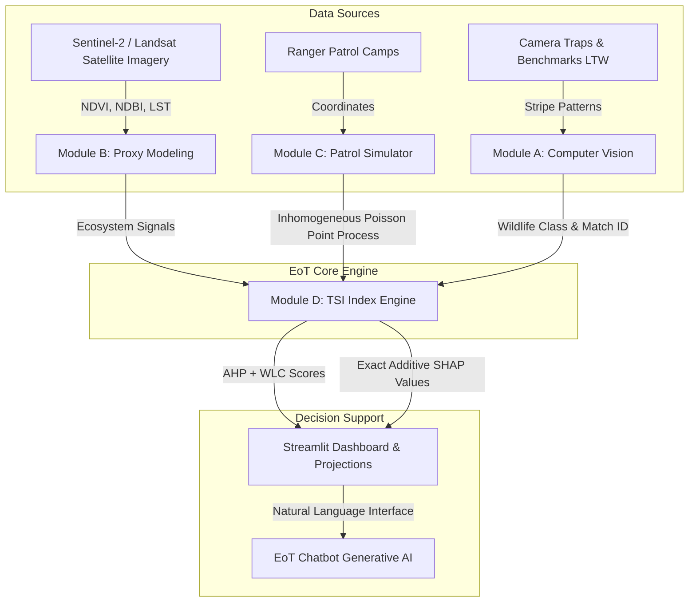

# Eyes on Tigers (EoT) 🐯

**Author:** Thrilok Manjunath (thrilokmanjunath@gmail.com) (https://eyes-on-tigers-7mtepkv8ruq3aaulgr7ves.streamlit.app)

[]()
[]()
[]()
[]()

> **Eyes on Tigers (EoT)** is an advanced, production-grade conservation monitoring and analytics platform. It replaces subjective, sparse assessments with rigorous multi-criteria decision models, feature-augmented regression for census-gap interpolation, and spatial point process simulators for threat detection.

---

## 1. Project Pitch & Value Proposition

Traditional tiger conservation metrics are bottlenecked by **extreme data sparsity** (official censuses run on a 4-year cycle) and **high data classification constraints** (ranger patrol routes and poaching logs are government-classified to prevent exploit by poachers).

**Eyes on Tigers (EoT)** breaks this bottleneck by providing:
1. **Proxy Modeling & Feature Augmentation:** Continuous yearly estimates interpolated using satellite imagery indicators (NDVI, NDBI, Land Surface Temperature) and prey densities.
2. **Dual-Data Pipelines:** Open-source benchmarking (Snapshot Serengeti, Labeled Tigers in the Wild) decoupled from spatial inhomogeneous Poisson Point Process simulators for ranger patrol telemetry.
3. **Analytic Hierarchy Process (AHP) & Explainable AI (XAI):** Mathematically rigorous Tiger Success Index ($TSI$) combined with exact analytical SHAP values to explain individual reserve performance relative to the national baseline.

---

## 2. Key Modules Breakdown

### 📸 Module A: Population Viability & Computer Vision
- **Objective:** Automate animal classification, identify individual tigers via unique stripe matching, and validate local counts.
- **Feeds:** Leverages benchmarks like **Labeled Tigers in the Wild (LTW)** and **Snapshot Serengeti** to evaluate CNN performance. Outputs species class, AI confidence, and individual stripe pattern match IDs.

### 🛰️ Module B: Habitat Integrity Monitor (GIS & Remote Sensing)
- **Objective:** Track forest health and habitat fragmentation.
- **Indicators:** Extracts continuous yearly signals including NDVI (Normalized Difference Vegetation Index), NDBI (Normalized Difference Built-up Index), LST (Land Surface Temperature), and calculates the Habitat Fragmentation Index ($HFI$).

### 🚀 Module C: Anti-Poaching Patrol Optimization
- **Objective:** Simulates patrol logs to evaluate conservation coverage and intervention latencies.
- **Simulator:** Uses spatial point processes to generate synthetic ranger walks starting from patrol camps, computes responses to poaching threat triggers, and models search efficiency.

### 📊 Module D: Tiger Success Index (TSI) Engine
- **Objective:** Solves subjective bias in composite conservation scoring using a mathematical framework based on WLC and AHP.
- **Explainability:** Decomposes TSI scores using exact linear SHAP values, pinpointing local conservation bottlenecks.

---

## 3. Mathematical Formulation

### A. Habitat Fragmentation Index ($HFI$)
The fragmentation score evaluates forest integrity by penalizing core area loss and patch isolation:
$$HFI = \alpha \cdot \left(1 - \frac{A_{\text{core}}}{A_{\text{total}}}\right) + \beta \cdot ED_{\text{norm}} + \gamma \cdot PD_{\text{norm}}$$
In our proxy remote-sensing model, this correlates to vegetation vigor (NDVI) and built-up encroachment (NDBI):
$$HFI = 1.0 - \left( w_1 \cdot \text{NDVI} + w_2 \cdot (1.0 - \text{NDBI}) \right)$$

### B. Tiger Success Index ($TSI$)
Derived using the **Analytic Hierarchy Process (AHP)**, criteria weights are solved from a consistent pairwise comparison matrix ($CI = 0$):
- **Population Sustainability ($TS$):** $0.40$ (tiger density and short-term growth)
- **Habitat Integrity ($HI$):** $0.30$ (NDVI and low fragmentation)
- **Anti-Poaching Effectiveness ($AP$):** $0.20$ (patrol coverage and intervention latency)
- **Prey Density ($PD$):** $0.10$ (carrying capacity)

Using the **Weighted Linear Combination (WLC)**:
$$TSI = 0.40 \cdot TS + 0.30 \cdot HI + 0.20 \cdot AP + 0.10 \cdot PD$$

### C. Model Explainability (SHAP Values)
For any reserve $r$, the deviation of its score from the national average $\overline{TSI}$ is decomposed into the sum of the marginal contributions of each feature (SHAP values):
$$\phi_k(r) = w_k \cdot (C_k(r) - \overline{C}_k)$$
Where $C_k(r)$ is the normalized criterion score for feature $k$, and $\overline{C}_k$ is the national average score for that criterion. Perfect additivity is guaranteed:
$$TSI(r) = \overline{TSI} + \sum_{k} \phi_k(r)$$

---

## 4. System Architecture Diagram



---

## 5. Data Strategy & Security Compliance

Ranger trajectories and core-zone poaching logs are highly classified by the National Tiger Conservation Authority (NTCA) to keep poachers from discovering patrol blind spots. 
- **Security Compliance:** All spatial coordinates shown in the UI are synthetically generated using an inhomogeneous Poisson Point Process where threat intensity $\lambda_{\text{threat}}(x, y)$ peaks at boundary zones:
  $$\lambda_{\text{threat}}(x, y) \propto \exp\left(-\frac{(d_{\text{center}}(x, y) - R_0)^2}{2\sigma^2}\right)$$
- **Dual-Data Decoupling:** Evaluates models on public benchmarking data assets, ensuring no sensitive federal location markers are leaked.

---

## 6. Comprehensive How-To-Use Guide

Welcome to the Eyes on Tigers (EoT) Dashboard! This guide will walk you through exactly how to set up, run, and interact with the platform.

### Step 1: Installation & Setup
1. **Clone the repository:**
   ```bash
   git clone https://github.com/thrilokmanjunath/eyes_on_tigers.git
   cd eyes_on_tigers
   ```
2. **Set up the Environment:**
   If you have Anaconda installed (recommended), ensure your environment has `pandas`, `streamlit`, `scipy`, and `plotly`. You can install them via:
   ```bash
   pip install -r requirements.txt
   ```

### Step 2: Configure the AI Assistant (Optional)
The platform features an intelligent Chatbot (EoT Assistant) that can answer complex data queries using Google's Gemini AI.
1. Create a `.env` file in the project root or export it in your terminal:
   ```bash
   export GEMINI_API_KEY="your_api_key_here"
   ```
   *(If skipped, the chatbot will fall back to a built-in rule-based engine).*

### Step 3: Generate the Core Datasets
Before running the dashboard, you need to generate the synthetic patrol data and analytical scores (TSI, SHAP, etc.).
1. Run the data generation script:
   ```bash
   python3 generate_data.py
   ```

### Step 4: Launch the Dashboard
We've included a convenient launch script to find Streamlit and start the server automatically.
1. Make the script executable and run it:
   ```bash
   chmod +x run.sh
   ./run.sh
   ```
   *(Alternatively, run `/opt/anaconda3/bin/streamlit run app.py` or `streamlit run app.py`)*

2. Open your web browser and navigate to the URL provided in the terminal (typically `http://localhost:8501`).

### Step 5: Navigating the Dashboard
Once the app loads, use the left sidebar to explore the modules:
- **National Overview:** View high-level metrics, the interactive map, and national trend lines.
- **State Explorer:** Deep dive into specific states to see localized performance and funding.
- **Financial Analysis:** Analyze ROI on conservation spending and track state budgets.
- **Mortality & Conflict:** View breakdown charts on poaching vs natural deaths, and human conflict hotspots.
- **CV & Patrol Explorer:** Explore the new Module A & C integration. Test the Synthetic Patrol Simulator and Computer Vision metrics.
- **EoT Bot:** Ask natural language questions like "Which state had the highest poaching deaths in 2022?".

---

## 7. Troubleshooting & FAQ

**Q: I get a "Command not found: streamlit" error when trying to run the app.**
**A:** This means Streamlit isn't in your system's PATH. If you're using Anaconda, try running the provided `./run.sh` script, which automatically looks for Streamlit in `/opt/anaconda3/bin/`. You can also manually run `/opt/anaconda3/bin/streamlit run app.py`.

**Q: The EoT Chatbot says "Data unavailable".**
**A:** Ensure you're asking about data explicitly provided in the dashboard (e.g. population up to 2022, deaths/funding up to recent years). Also, verify your `GEMINI_API_KEY` is active, otherwise the bot uses a strict rule-based fallback.

**Q: How is the Tiger Success Index (TSI) calculated?**
**A:** The TSI is a mathematical scoring model using the Analytic Hierarchy Process (AHP). It combines Population, Habitat, Anti-Poaching, and Prey Density into one normalized score. See the "Module D" section above for the math.

**Q: Why are the patrol coordinates generated randomly?**
**A:** To comply with National Tiger Conservation Authority (NTCA) security regulations, true ranger patrol paths cannot be displayed. The dashboard uses an *Inhomogeneous Poisson Point Process* to simulate realistic patrol paths focusing on high-risk boundary areas.

---

## 7. Directory Structure Tree

```
eyes_on_tigers/
├── app.py                      # Main navigation controller & app runner
├── generate_data.py            # Recreates all CSV data assets & simulates runs
├── requirements.txt            # Python dependencies
├── src/                        # Core algorithmic modules
│   └── eot_engine/
│       ├── __init__.py
│       ├── proxy_modeling.py   # Regression-based census gap interpolation
│       ├── synthetic_patrol.py  # Spatial Poisson Point Process simulator
│       └── tsi_model.py        # AHP-WLC scoring & SHAP XAI calculation
├── utils/                      # Helper scripts
│   ├── __init__.py
│   ├── chart_cache.py          # Visual asset cache for fullscreen popouts
│   ├── chatbot_agent.py        # Chatbot prompt parser & Gemini client
│   ├── map_utils.py            # Streamlit mapping and CSS layouts
│   └── data_loader.py          # Data ingestion and preprocessing utilities
├── views/                      # UI pages
│   ├── home_page.py
│   ├── 01_national_overview.py
│   ├── 02_state_explorer.py
│   ├── 03_financial_analysis.py
│   ├── 04_mortality_conflict.py
│   ├── 05_growth_analysis.py
│   ├── 05_eot_bot.py           # Rebranded chatbot page
│   └── 06_cv_patrol_explorer.py # Interactive model explorer
└── data/                       # Local CSV and spreadsheet datasets
```

---

## 8. Project Roadmap

- [ ] **Phase 1: Live GIS Integration**
  - Connect dynamic APIs to pull real-time NDVI and LST from Google Earth Engine (GEE).
  - Deploy standard webhooks for Automated Alerting.
- [ ] **Phase 2: Surveillance Edge Deployment**
  - Port Module A to low-power edge computing devices (drones, smart camera traps).
  - Integrate LoRaWAN telemetry network for real-time ranger alerts.
